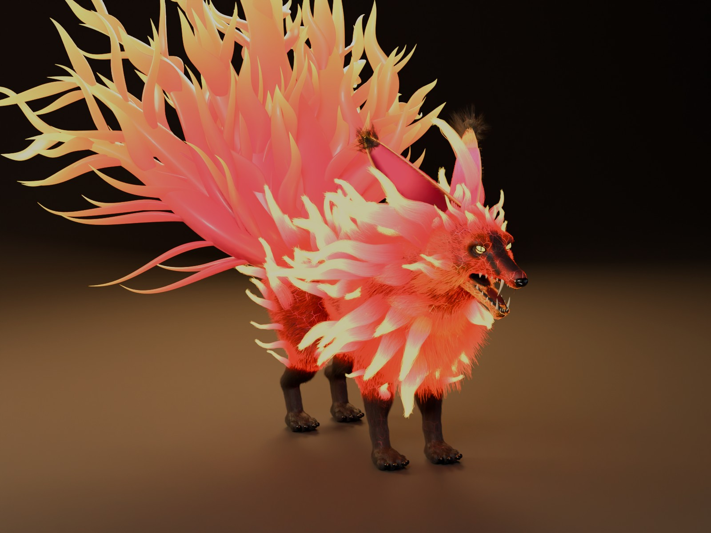
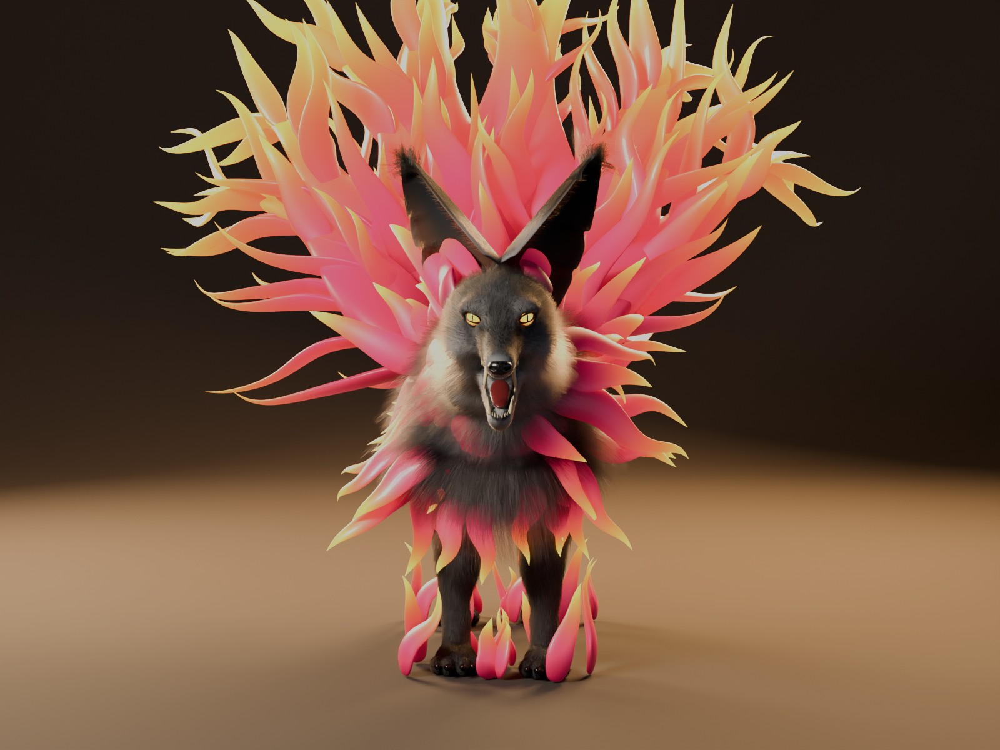
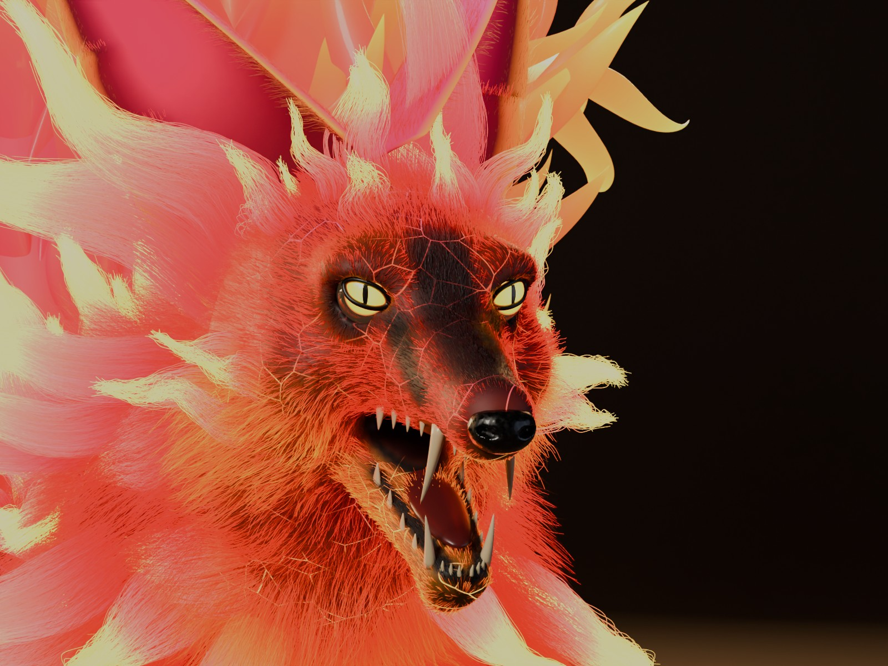
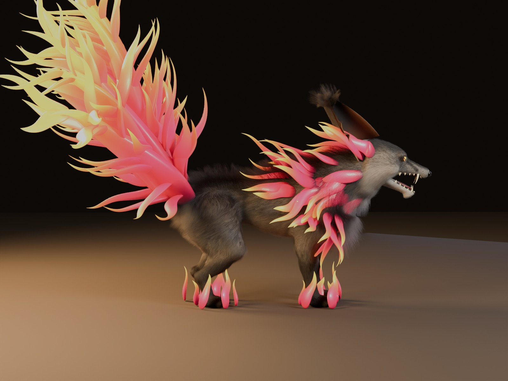
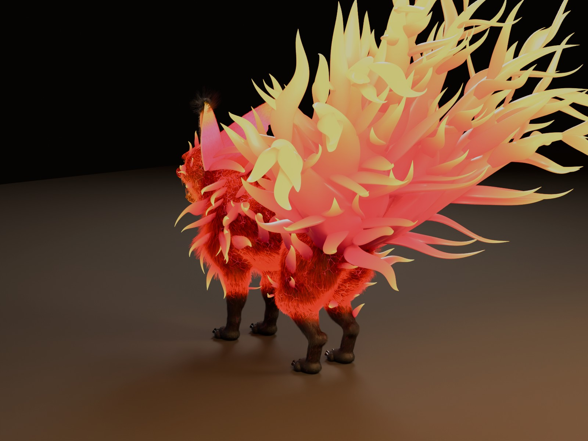
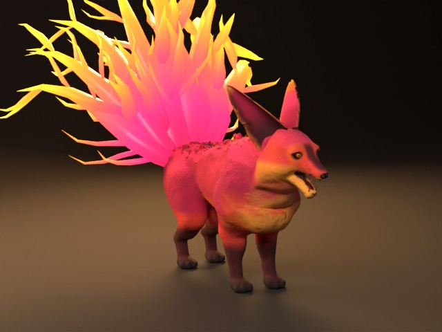
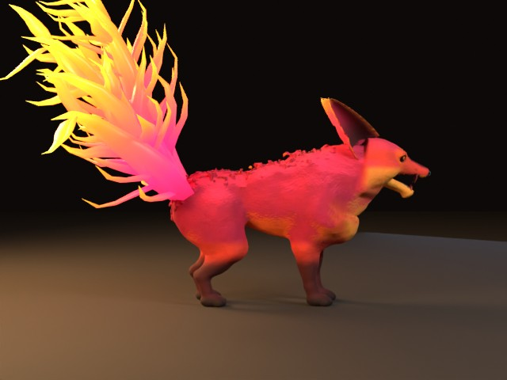

# Nine-Tailed Fire Fox — Blender 5.2 generator + Roblox boss asset

A colossal fox made of fire. Its coat burns from deep ember-red at the skin through magenta and
hot pink to glowing orange-yellow tips, glowing lava veins show through the fur, flames rise off
its back, flanks and legs, a crown of fire sweeps back from its head, and nine huge flame tails
fan out behind it. It stands on four hulking legs with charred black paws, snarls with saber
fangs, and stares with white-hot slit eyes. About **12 studs tall** in Roblox (ground to ear
tips; the tails tower above that).

Everything is generated by one script, `desert_fox.py`, with stock **Blender 5.2 LTS**: no
add-ons, no external files.



| | |
| --- | --- |
|  |  |
|  |  |

Roblox game version (Blender preview of the exported meshes):

| | |
| --- | --- |
|  |  |

| Version | What it is | Use it for |
| --- | --- | --- |
| **HQ / cinematic** | one continuous sculpted body, 353k glowing hair strands at medium (coat + 40k "flame fur" strands combed into flame tongues), lava-vein skin, nine solid flame tails that fade into the fur, layered eyes, 32 teeth, tongue, claws | Blender renders, promo art |
| **Roblox** | body mesh (13,302 tris, baked colour/normal/roughness) + flame mesh (5,724 tris, the nine tails, fire-gradient texture) + 51-bone rig, one FBX | the game |

**Final build (medium, Blender 5.2.2 LTS, 4-core CPU):** creature scale ×6.38 → 3.36 m /
12.0 studs tall; Roblox size 5.4 × 15.2 × 12.0 studs (w × l × h, body). Build + Roblox bake
≈ 11 min; each 1600×1200 CPU render ≈ 5–9 min.

## 1. Run the script

**In Blender 5.2 (GUI)**

1. Start Blender 5.2 and choose **File → New → General** (the script refuses to wipe a file that
   has your own work in it).
2. Go to the **Scripting** workspace → **Text → Open…** → `desert_fox.py`.
3. Optional: edit the `SETTINGS` block at the top (`quality`, `render`, `out_dir`).
4. Press **Run Script**. A progress bar shows in the status bar; details print to the system
   console (Windows: **Window → Toggle System Console**). Expect ~10 minutes at `medium`.
5. Output (default `~/DesertFox_Output`, i.e. `C:\Users\<you>\DesertFox_Output` on Windows):
   `DesertFox.blend`, `roblox/…`, and `renders/…` if rendering was on.

**Headless**

```bash
blender --background --python-exit-code 1 --python desert_fox.py -- --quality high --render
```

Options after `--`: `--quality draft|medium|high`, `--render`, `--views front_3q,face_closeup`,
`--no-roblox`, `--out <folder>`.

| Quality | Fur strands (approx.) | Mesh voxel* | Samples | Resolution |
| --- | --- | --- | --- | --- |
| draft | ~127k | 2.4 mm | 24 | 960×720 |
| medium | ~313k | 1.7 mm | 64 | 1600×1200 |
| high | ~570k | 1.3 mm | 128 | 2048×1536 |

\*measured on the model before the creature scale (×6.38) is applied.

## 2. How it is built

* **Anatomy**: a signed-distance-field sculpt meshed by a built-in surface-nets mesher: barrel
  ribcage, deep chest and pectorals, hunched trapezius hump, massive scapulae and deltoids, lats,
  bull neck, big haunches; broad cranium, heavy frowning brow, cheekbones, muzzle with snarl
  folds, lips pulled back from the fangs, separate lower jaw opened 22°, carved mouth cavity,
  almond eye openings slanted 22°; thick digitigrade legs, oversized four-toed paws.
* **Pose**: neck lowered 16°, head lifted 13° into a glare and enlarged ×1.22, jaw open.
* **Fire coat**: hair curves (underfur + guard hairs) following an anatomical flow field, with
  bristling hackles and crest. Colour masks put deep crimson on the chest, hot pink on the back,
  amber on cheeks and throat, a dark ember mask around the eyes and muzzle (so the face reads),
  and charred lower legs and paws. Each hair glows more toward its tip. Under the fur the skin is
  dark magma with patchy glowing lava veins.
* **Flames that are part of the body**: the flames on the mane, back, flanks, hips, upper legs and
  head are *hair*: tufts of glowing strands rooted in the skin and combed along S-curved flame
  paths so they converge into flame tongues (outer strands stop early, giving flickering
  sub-tips). Each strand starts in the coat's own colour at the root and runs hot pink → orange →
  yellow-hot at the tip, glowing more toward the tip, so the fur itself burns. The nine tails are
  solid flame shapes (fat core + wide curling tongues) whose roots are transparent, so they melt
  into the burning fur on the rump. No fire on the feet.
* **Details**: eyeball with procedural iris, slit pupil and strong glow, glass cornea, eyelid
  rims, wet nose, 32 teeth (saber canines), tongue, gums, 16 hooked claws, paw pads, cupped ears
  with torn notches, glowing rims and black tip tufts.

## 3. Render setup

* Cycles, adaptive sampling, OpenImageDenoise.
* **Colour management: Standard** (AgX/Filmic turn the saturated fire pastel).
* Hair shape: 3D curves (`Render Properties → Curves`) at medium/high.
* Dark studio with a dim key, cool fill and orange rims; the creature is the main light source.
  Lights and cameras scale with the creature.
* Cameras: `Cam_front_3q`, `Cam_side`, `Cam_front`, `Cam_rear_3q`, `Cam_face_closeup` (105 mm,
  shallow depth of field on the eyes).
* CPU rendering is slow with this much hair; a GPU (Preferences → System → Cycles Render
  Devices) is much faster.

## 4. Roblox asset

Folder `roblox/`:

| File | What |
| --- | --- |
| `DesertFox_Roblox.fbx` | armature + `Fox_Roblox` (body) + `Fox_Flames` (the nine flame tails), textures embedded |
| `FoxRoblox_Color.png` / `_Normal.png` / `_Roughness.png` | 1024 px body maps (normal map is OpenGL / +Y) |
| `FoxRoblox_Fire.png` | the fire gradient used by the flame mesh |

* **Body mesh**: the skin pushed out by the local fur length (so the outline stays furry, with
  big tufts and crest spikes), voxel-remeshed, decimated, plus low-poly ears, eyes, nose, teeth
  and tongue; unwrapped on a smoothed copy and packed; fire colours, fur grooves (following the
  hair direction) and roughness baked from the detailed sources.
* **Flame mesh**: low-poly versions of the nine tails, UV-mapped onto a gradient whose roots are
  transparent so they fade into the rump. The flames on the mane, back, legs and head are hair in
  the HQ version; in the game they are part of the baked body texture, because low-poly flame
  shapes there look like blades stuck into the body.
* **Rig (51 bones)**: `Root → Hips → Spine1 → Spine2 → Chest → Neck → Head → Jaw`,
  `Ear.L/R → EarTip.L/R`, `FrontUpperLeg / FrontLowerLeg / FrontFoot .L/.R`,
  `BackUpperLeg / BackLowerLeg / BackFoot .L/.R`, and `FireTail1_1…_3` … `FireTail9_1…_3`
  (three per tail). Skin weights: max 4 influences, jaw/ears/head/legs separated cleanly
  (checked by posing the jaw, head, ears, legs and tail bones).
* Export: 1 Blender unit = 1 stud (scene unit scale 0.01 + *FBX Units Scale*), −Z forward,
  +Y up, triangulated before baking, no leaf bones, no animation.

## 5. Import into Roblox Studio

1. **Home → Import 3D** → `DesertFox_Roblox.fbx`.
2. Keep it as a **skinned model with bones** (do not convert to R15). Check the preview: it faces
   forward and stands on the grid, about 12 studs to the ear tips. Change the importer scale or
   use `Model:ScaleTo()` if you want it bigger or smaller.
3. You get a Model with two MeshParts (`Fox_Roblox`, `Fox_Flames`) and the bones.
4. **Body textures**: add a **SurfaceAppearance** to `Fox_Roblox` with ColorMap =
   `FoxRoblox_Color.png`, NormalMap = `FoxRoblox_Normal.png`, RoughnessMap =
   `FoxRoblox_Roughness.png`.
5. **Fire**: add a **SurfaceAppearance** to `Fox_Flames` with ColorMap = `FoxRoblox_Fire.png`
   and **AlphaMode = Transparency**. That keeps the red→orange→yellow gradient and makes the
   flame roots fade into the body instead of sticking out of it. Don't switch it to `Neon`
   (Neon ignores the transparency, so the roots show as hard edges again). For a glow, add a few
   `PointLight`s (orange/pink, Range 10–16) inside the neck and tails; a `ParticleEmitter` with
   embers on the tails sells it further.
6. **Eyes**: add a small orange `PointLight` in the head (or neon parts) — Roblox has no emissive
   texture slot.
7. Animate with the **Animation Editor** (bones are supported): walk, pounce, roar (Jaw), ear
   flicks, and swishing each of the nine tails.
8. Gameplay: give the boss its own invisible hitbox Part; set the MeshParts'
   `CollisionFidelity = Box` (or `CanCollide = false`).

Not transferable to Roblox: hair strands, the refractive cornea, procedural shader nodes and
emission — the game version imitates them with geometry, baked textures and the gradient.

## 6. Quality checklist

Measured on the final build; the Roblox checks re-import the exported FBX and pose its bones.

| Check | Result |
| --- | --- |
| Anatomy | Continuous SDF body; validation passed; all four paws flat on the ground (636 / 795 / 812 / 697 contact vertices) |
| Fur coverage | 353,426 strands at medium (incl. 40,327 flame-fur strands); no fur on eyes, nose, lips or inside the mouth |
| Fire | Body flames are hair grown from the skin (no solid pieces stuck in); tail roots fade to transparent; none on the feet |
| Eyes | Separate eyeball (iris fibres, limbal ring, slit pupil, glow), glass cornea, eyelid rims, slanted almond opening |
| Ears | Thick cupped pinnae, forward-curling rims, asymmetric torn notches, glowing rims, black tip tufts |
| Mesh integrity | Roblox body voxel-remeshed (manifold) before decimation; tooth winding verified on both sides |
| UVs | Smart UV on a smoothed copy + packed islands; flames mapped onto a gradient strip |
| Polygon budget | Roblox body 13,302 tris, flames 5,724 tris (limit 20,000 per MeshPart) |
| Rigging | 51 bones, no leaf bones; every vertex ≤ 4 influences, weights sum to 1.000. Posing tests: Jaw moves only the jaw (both sides evenly), Ear.L only the left ear, FireTail bones only their flames, FrontUpperLeg.L and BackLowerLeg.R only their own side, Head carries skull, ears, eyes and teeth together |
| Export | −Z forward, +Y up, triangulated, textures embedded (Color, Normal, Roughness, Fire) |
| Roblox import | Coordinates are in studs (1 unit = 1 stud), ~12 studs tall. **Not test-imported in Roblox Studio** (not available here): check the importer preview size and facing on first import |
