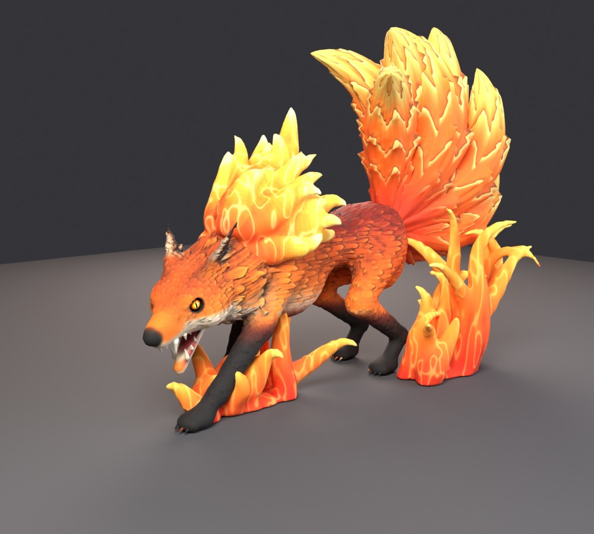
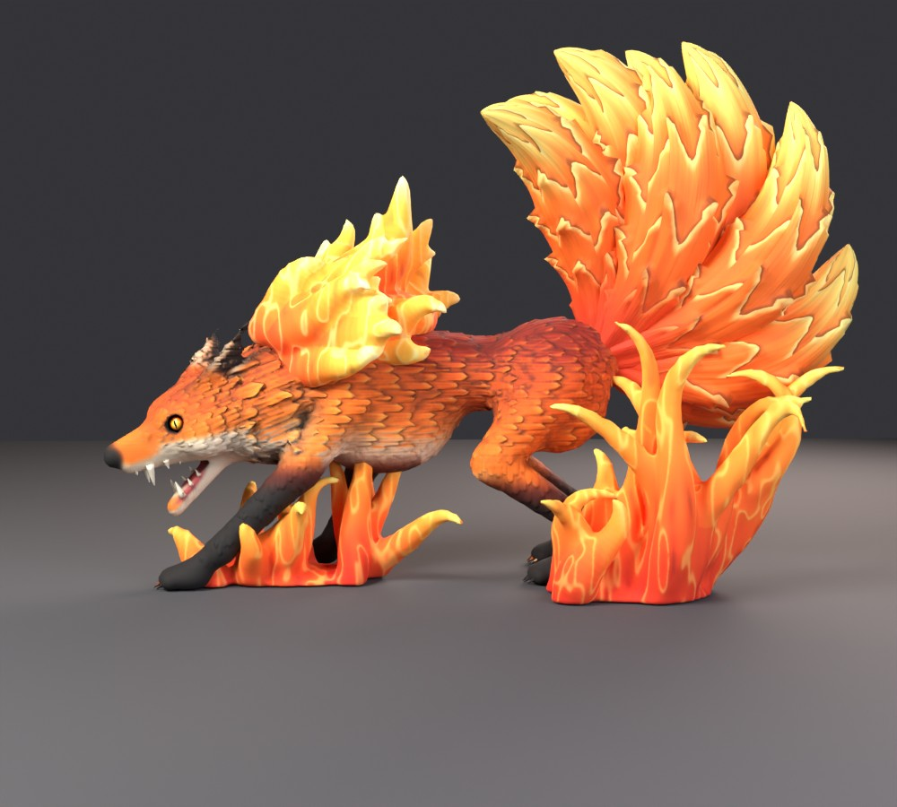
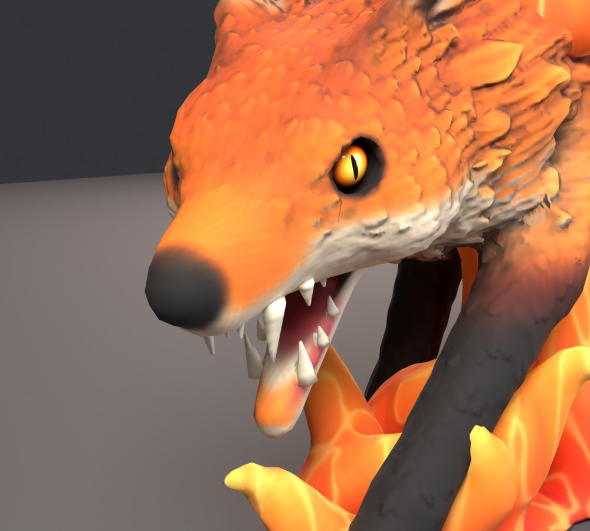
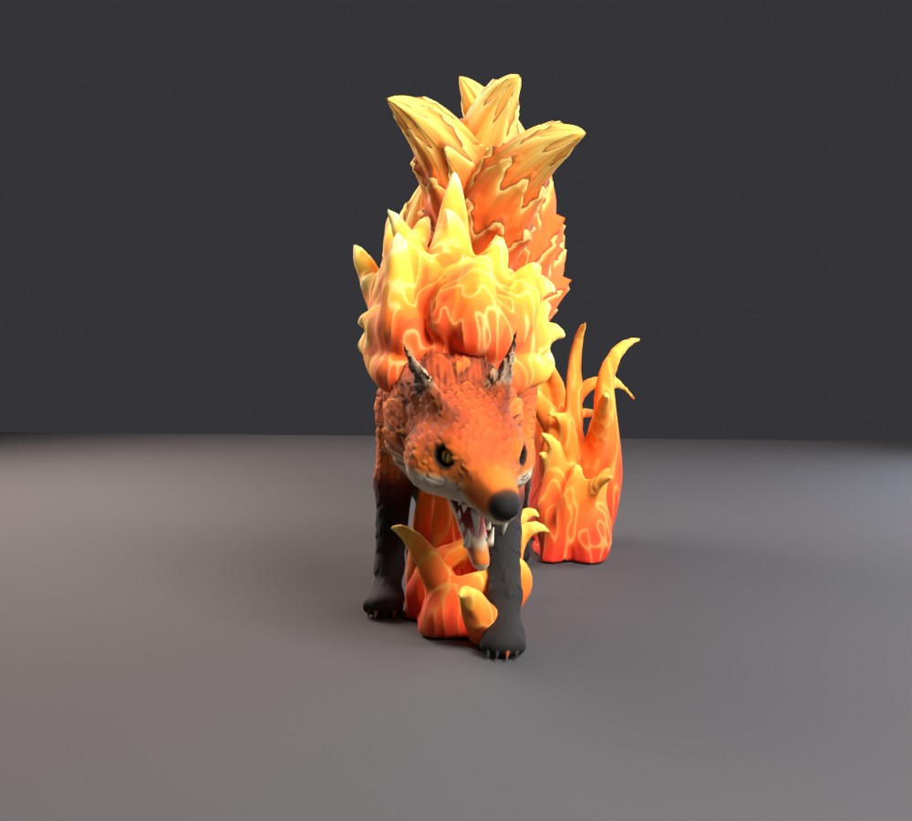
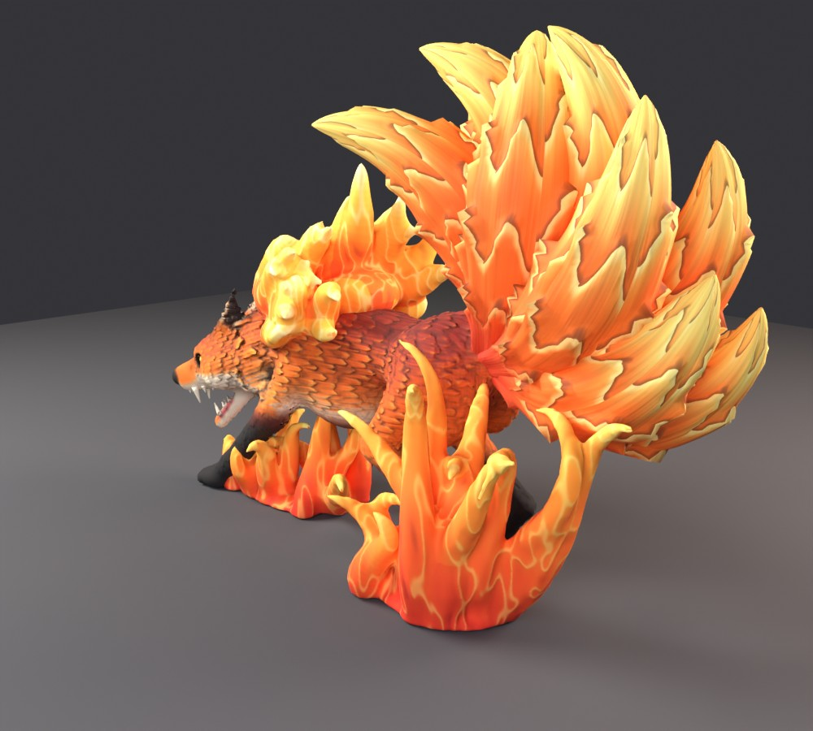

# Nine-Tailed Flame Fox: Roblox model

A fire fox with nine feathery flame tails, crouched to pounce, snarling with its jaw open. It's
modelled after a nine-tailed wolf statue, without the stand. Everything is generated by one
script, `nine_tailed_wolf.py`, in Blender 5.2.



| | |
| --- | --- |
|  |  |
|  |  |

The pictures are rendered from the exported `FlameWolf.fbx` itself (re-imported into Blender),
so they show the low-poly game meshes and their textures, not a high-detail version. Roblox
lighting will look a bit different.

## What's in `roblox/`

| File | What it is |
| --- | --- |
| `FlameWolf.fbx` | the whole fox, textures embedded |
| `FlameWolf_Setup.lua` | one-time Studio script: anchors parts, adds glow lights and embers |
| `Fox_Head_Color.png`, `Fox_Head_Normal.png` | head textures (1024 px) |
| `Fox_Body_Color.png`, `Fox_Body_Normal.png` | body textures (1024 px) |
| `Tails_Color.png`, `Tails_Normal.png` | shared by the three tail parts |
| `Mane_Color.png`, `Mane_Normal.png` | flame mane |
| `Fire_Color.png`, `Fire_Normal.png` | ground fire |
| `Eyes_Color.png` | eyes (amber iris, slit pupil) |

MeshParts in the model:

| Part | Triangles | Notes |
| --- | --- | --- |
| `Fox_Body` | 18,329 | body, legs, claws |
| `Fox_Head` | 7,446 | head, ruff, ears, teeth (own texture for a sharper face) |
| `Fox_Eyes` | 1,248 | both eyes |
| `Tails_A`, `Tails_B`, `Tails_C` | 14,112 each | three tails per part |
| `Flames_Mane` | 13,000 | flame mane on the neck and shoulders |
| `Flames_Fire` | 15,000 | ground fire (optional, delete it if you don't want it) |
| **Total** | **97,359** | |

Each part is under Roblox's 20,000-triangle limit.

## Import into Roblox Studio

1. **Home → Import 3D** (or **Avatar → Import 3D**) → pick `roblox/FlameWolf.fbx`.
2. In the importer, keep it as one model. The preview should show the fox standing on the grid,
   facing forward, about 18 studs tall at the tail tips, 25 long and 11 wide. Click **Import**.
3. Check the textures. Each part should have a **SurfaceAppearance** with its ColorMap and
   NormalMap. If a part shows up plain grey, add a SurfaceAppearance to it and set:
   - `Fox_Head`: ColorMap `Fox_Head_Color.png`, NormalMap `Fox_Head_Normal.png`
   - `Fox_Body`: `Fox_Body_Color.png`, `Fox_Body_Normal.png`
   - `Tails_A`, `Tails_B`, `Tails_C`: `Tails_Color.png`, `Tails_Normal.png`
   - `Flames_Mane`: `Mane_Color.png`, `Mane_Normal.png`
   - `Flames_Fire`: `Fire_Color.png`, `Fire_Normal.png`
   - `Fox_Eyes`: ColorMap `Eyes_Color.png`
4. Click the model in the Explorer, open **View → Command Bar**, paste all of
   `roblox/FlameWolf_Setup.lua` and press Enter (run it once). It anchors everything, makes the
   flames and tails non-solid, and adds orange PointLights to the fire, the mane and the eyes,
   plus rising embers on the ground fire. Roblox has no glowing textures, so these lights are
   what make the fire glow.
5. Resize with `Model:ScaleTo(…)` or the Scale tool if you want it bigger or smaller.

**Don't want the ground fire?** Delete the `Flames_Fire` part. The fox stands on its own.

**Collisions:** for an NPC, give it its own simple hitbox Part and set the MeshParts'
`CollisionFidelity` to `Box` (Properties panel) so physics stays cheap.

## How it's made

* **Body:** a signed-distance-field sculpt (deep chest, lean waist, haunches, crouched pose,
  front leg reaching forward) meshed with surface nets. The head has brows, cheeks, a muzzle with
  snarl wrinkles, an open jaw with 18 teeth, a tongue, eye sockets and big ears pinned back. A
  shaggy ruff of tufts surrounds the neck.
* **Fur:** the coat is carved as overlapping fur locks with pointed tips. They flow backwards
  over the body and head and downwards on the legs, chest and rump, with creases between locks
  and strand grooves inside them.
* **Colour:** smooth fox markings (deep red saddle, orange sides, cream chest, throat and cheeks,
  black stockings, dark ear backs with black tips) plus colour from the same fur field: each lock
  has its own shade, a golden tip and a darker root. Ambient occlusion from the distance field
  darkens creases and tucked-in areas, so the paint follows the sculpt.
* **Game meshes:** the detailed sculpt (~700k triangles) is baked onto low-poly meshes as
  1024 px colour and normal maps. The head is its own part with its own texture (twice the
  detail on the face); the cut sits under the ruff and both parts share the same normals, so no
  seam shows.
* **Tails:** nine swept plumes fanned from "up over the back" to "straight back". Each is built
  from layered locks with V-shaped tips, red at the root through orange to golden tips.
* **Flames:** curling flame tongues smooth-merged into one sculpted mass (mane on the neck and
  shoulders; ground fire under the chest and beside the hind leg), with carved streaks.
* **Eyes:** separate glossy eyeballs with an amber iris, black slit pupil and a catchlight.

## Rebuild

```bash
pip install bpy==5.2.2            # Blender as a Python module (Python 3.13), or use Blender 5.2
python nine_tailed_wolf.py --out out --render
# or: blender --background --python nine_tailed_wolf.py -- --out out --render
```

`--quick` builds coarse meshes without baking (a fast shape check); `--views ref,face` renders
only some views. A full build with renders takes about 10 minutes on 4 CPU cores.

## Checks

Measured on the final build. The size and texture checks re-import the exported FBX the way
Roblox reads it (1 cm in the file = 1 stud).

| Check | Result |
| --- | --- |
| Triangles per part | largest 18,329 (`Fox_Body`); Roblox limit 20,000 |
| Size in Roblox | 10.9 × 25.5 × 18.2 studs (w × l × h) |
| Textures | 1024 px colour + normal maps, embedded in the FBX; every part keeps its UVs and texture after re-import |
| Bake errors | missed texels and flipped normals (from rays hitting a neighbouring flame tongue) repaired; 0 normals tilted more than 70° in the final maps |
| Head/body cut | both parts use the normals of the uncut mesh, so the shading matches across the cut |
| Paws | flattened onto the ground plane (y = 0 in Roblox) |

Not test-imported in Roblox Studio (not available here). Check the importer preview's size and
facing on the first import.
